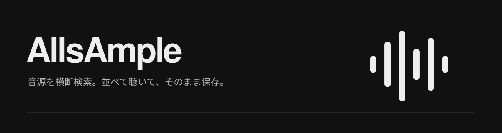
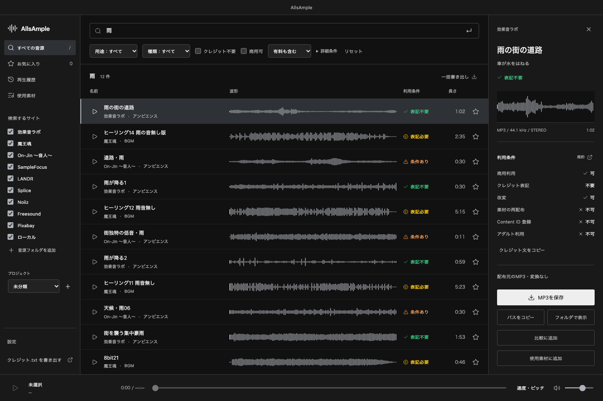
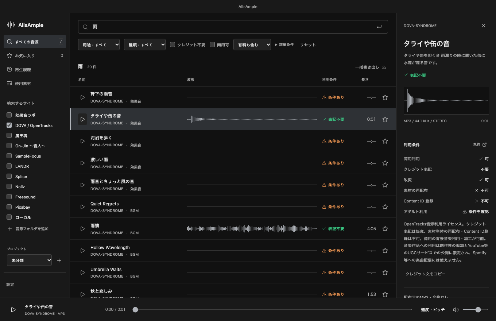
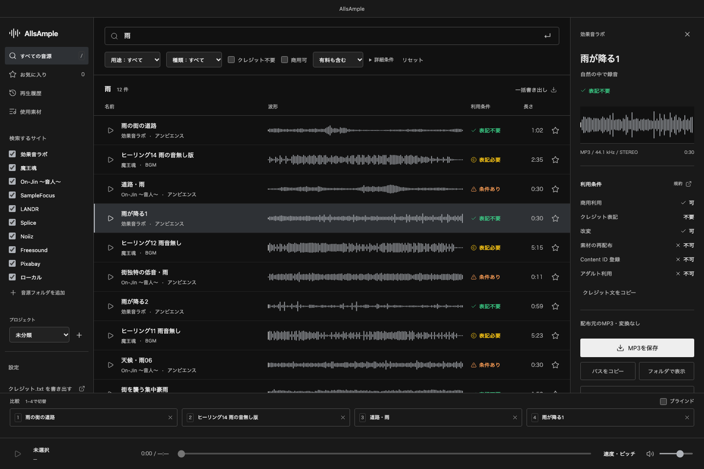
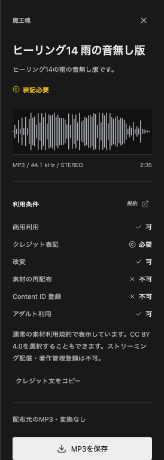
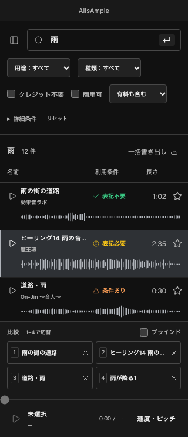
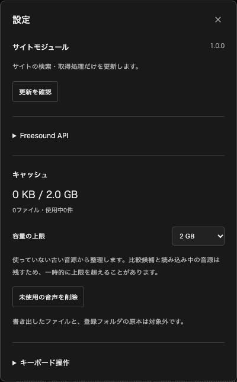

<p align="center">
  
</p>

<p align="center">
  <a href="https://github.com/nisesimadao/AllsAmple/releases/latest"><strong>ダウンロード</strong></a> ·
  <a href="INSTALL-ja.md">インストール・使い方</a> ·
  <a href="https://github.com/nisesimadao/AllsAmple/issues">不具合を報告</a>
</p>

複数の音素材サイトを、ひとつの検索窓で探すデスクトップアプリです。
音楽制作でも映像編集でも、サイトを行き来せずに聴き比べて、必要な音を保存できます。

Windows / macOS · 日本語UI · アカウント登録・サーバー不要



<sub>実装済みの画面をheadless Chromiumで撮影。公開ページのメタデータと実際の音源から得た波形を使用しています。音源は同梱しません。</sub>

## 探す、聴く、保存する

1. 「雨」「キック」「ピアノ」などで検索。日本語は英語の類義語にも展開します。
2. **↑ / ↓** で候補を選び、**Space** で試聴。再生中に移動すると次の音へ切り替わります。
3. **Enter** で保存。パスのコピー、Finder / Explorer表示、一括書き出しも使えます。
4. **行のタイトル部分をドラッグ**すると、音声ファイルとして他のアプリへ渡せます。波形部分のドラッグは頭出しです。

ホバーでは音を鳴らさず、次の試聴に備えて先読みします。
映像用・音楽用の切り替えは、サイトや絞り込み条件を用途別に記憶します。

DOVA-SYNDROME（現OpenTracks）のBGM・効果音も検索できます。作者の追加条件を確認できた素材から、利用条件の表示を更新します。



## 並べて聴き比べる

候補を **b** で4件まで比較トレイへ。**1〜4** で切り替えて聴けます。
ブラインドではタイトルとサイト名を隠し、音だけで選べます。
速度とピッチを調整しても、保存するファイルには変更を加えません。



## 利用条件を見て選ぶ

素材ごとの条件を、色とアイコンで表示します。
商用利用やクレジット不要で絞り込み、詳細から規約を確認できます。
使用した素材をプロジェクトに残しておけば、必要な表記だけを **クレジット.txt** に書き出せます。

| 表示 | 意味 |
| --- | --- |
| ✓ 緑 | 商用可・クレジット不要 |
| © 黄 | 商用可・クレジット必要 |
| △ 橙 | 条件あり |
| ◇ 灰 | 有料サイトの試聴用音源 |
| ? 赤 | 条件未確認 |

<details>
<summary>利用条件の詳細と320px幅の画面</summary>
<br>


</details>

無料であることと、自由に使えることは別です。取得しても新しい利用許諾は付与されません。
試聴用MP3か配布元の素材かを明示し、形式は変換せずに保存します。

## 対応サイト

| サイト | 取得する音源 |
| --- | --- |
| [効果音ラボ](https://soundeffect-lab.info/) | 配布MP3 |
| [DOVA-SYNDROME / OpenTracks](https://opentracks.com/) | BGM・ジングル・効果音の配布MP3を優先 |
| [魔王魂](https://maou.audio/) | 配布WAVを優先、なければMP3 |
| [On-Jin ～音人～](https://on-jin.com/) | 配布MP3 |
| [SampleFocus](https://samplefocus.com/) | 試聴MP3 |
| [LANDR Samples](https://samples.landr.com/browse) | 試聴MP3 |
| [Splice](https://splice.com/sounds/search/samples) | 試聴MP3 |
| [Noiiz](https://www.noiiz.com/sounds/samples) | 試聴MP3 |
| [Freesound](https://freesound.org/) | 素材別ライセンスのHQプレビュー |
| [Pixabay](https://pixabay.com/) | 音楽・効果音の試聴MP3 |

自分のローカルフォルダも混ぜて検索できます。登録フォルダ・お気に入り・履歴・プロジェクトは端末に保存されます。
Freesoundはキーなしでも使え、必要なら公式APIキーを設定できます。

## サイトの修正は、小さなモジュールで

サイトのHTMLが変わるたびに、アプリ全体を入れ直す必要はありません。
設定の **サイトモジュール → 更新を確認 → モジュールを取得** で取得し、次回起動時に読み込みます。

```text
GitHub Releases → サイト取得モジュール → 次回起動時に読み込み
                     約95 KB             本体の差し替えなし
```

ネットにつながらない場合も同梱版で動きます。取得が壊れていた場合は読み込まず、実行時に失敗した場合も同梱版に戻します。
画面・再生エンジンなど本体を変更した場合だけ、新しいアプリをダウンロードします。

<details>
<summary>モジュール更新の設定画面</summary>
<br>

</details>

## 開発

```sh
npm ci
npm start
npm test
```

[開発・検証](docs/DEVELOPMENT.md) · [構成](docs/architecture.md) · [配布・モジュール更新](docs/release.md)

[SampleTap](https://github.com/nisesimadao/SampleTap)の取得ロジックと14件の回帰テストを無改変で移植しています。

## ライセンス

[MIT](LICENSE)。音源の権利は各サイト・作者に帰属します。
使用するライブラリと移植元の表記は[THIRD_PARTY_NOTICES.md](THIRD_PARTY_NOTICES.md)にまとめています。
